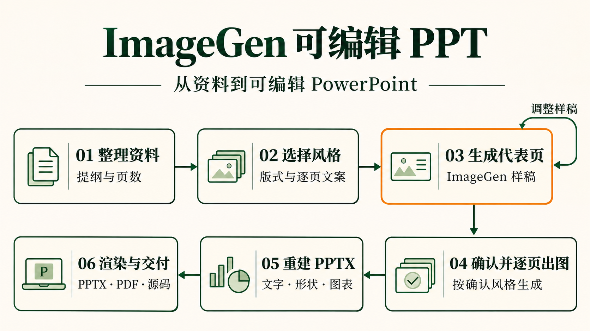
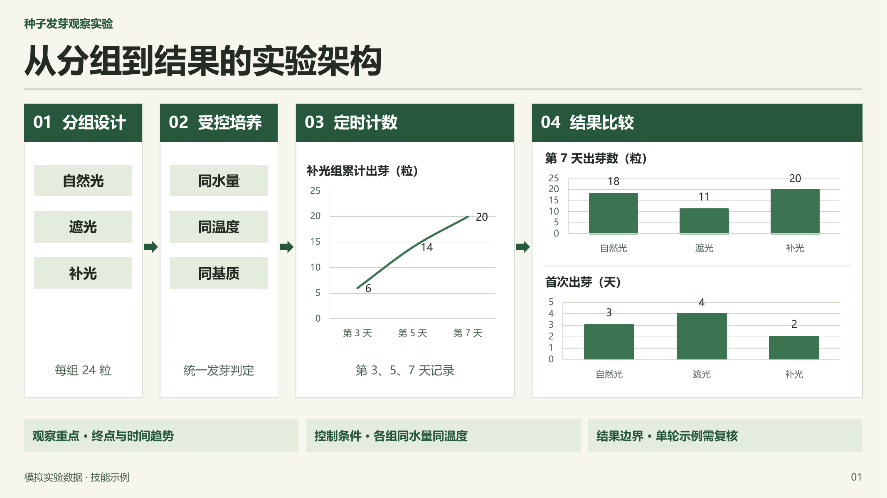

# ImageGen 可编辑 PPT

一套把想法、文档或定稿幻灯片原型转成可编辑 PowerPoint 的 Codex 技能。支持 **11 类风格、33 个子风格**，包括创赛路演、研究报告、咨询汇报和杂志编辑。适合先看样稿、再制作整套演示文稿的任务。



## 安装

在 PowerShell 中运行以下命令。克隆私有仓库时，需用有仓库访问权限的 GitHub 账号认证。

```powershell
git clone https://github.com/Mathiew-han/imagegen-editable-ppt.git "$env:USERPROFILE/.codex/skills/imagegen-editable-ppt"
```

打开新的 Codex 聊天，用 `$imagegen-editable-ppt` 调用技能。也可以在聊天里指定仓库根目录的 [SKILL.md](SKILL.md)。ImageGen 用于生成原型。PPTX 重建与预览依赖运行环境能创建 PowerPoint 对象并渲染幻灯片。

## 使用

1. 提供想法、文档、表格或定稿原型图，并说明演示场景、目标页数、比例和偏好的风格。可在 [风格索引](references/styles.md) 选择，如墨绿学术、铜金非遗或黑金硬科技。
2. 根据提纲和逐页文案生成一张代表页。先核对版式、字体层级和信息密度，再确认样稿。已有定稿原型时，可直接要求逐页重建。
3. 确认后逐页出图。用独立的文本框、形状、连接线、表格和带工作簿的 PowerPoint 原生图表重建页面，保留必要的局部图片。
4. 渲染并逐页对照。完整制作任务交付可编辑 PPTX、PDF 预览、可复现源码和必要素材，以及核验说明。

**研究报告示例指令**

> 请用 `$imagegen-editable-ppt` 把我提供的实验方案做成 6 页 16:9 组会汇报，使用墨绿学术风。以架构图或流程图为主，统计图嵌入对应研究节点，文本框说明条件和限制。图表以我提供的工作簿为准。先生成一张含图表的代表页给我确认。

**创赛路演示例指令**

> 请用 `$imagegen-editable-ppt` 把我提供的项目材料做成 8 页创赛路演，使用黑金硬科技风。正文保留章节导航、技术主视觉和验证材料区。项目阶段、指标和证明材料按我提供的资料填写。先生成一张核心技术页。

## 成品展示

### 研究报告 · PowerPoint 示例

在一页实验架构中，`定时计数` 节点内嵌折线图，`结果比较` 节点内嵌两张柱形图。下载后可在 PowerPoint 中修改节点、文字和原生图表数据。示例使用模拟实验数据。



[下载可编辑 PPTX](examples/research-demo.pptx) · [PDF 预览](examples/research-demo.pdf)

### 创赛路演 · ImageGen 代表页

「巡光智检」是虚构项目样例，展示黑金硬科技路演的章节导航、主视觉、四个技术模块和三栏落地信息。


## 项目文件

| 文件 | 作用 |
| --- | --- |
| [SKILL.md](SKILL.md) | 技能入口与执行顺序 |
| [风格索引](references/styles.md) | 11 类风格及各自的版式提示 |
| [策划和出图提示词](references/planning-imagegen-prompts.md) | 从提纲、代表页到逐页原型 |
| [重建和核验提示词](references/rebuild-qa-prompts.md) | 原生对象重建、渲染检查和交付 |
| [流程图生成提示词](assets/workflow-prompt.md) | 用于生成本页流程图的 ImageGen 提示词 |
